# Сбер ТВ **SaluteTV AT30A6** → Free My TV, без мусора Сбера

Готовый набор для телевизора **SaluteTV (Сбер ТВ), модель AT30A6**: вместо лаунчера Сбера — русский домашний экран [Free My TV](https://github.com/simbasjungles/free-my-tv), приложения Сбера удалены, а вернуться сами они не могут — за этим следит отдельное приложение-сторож «Сбер-Стоп». Всё сделано по ADB, без разборки, без смены прошивки и без root.

> **EN (short):** Everything you need to de-Sber a **SaluteTV AT30A6** (Amlogic T5W, Android 13, 2 GB RAM, 43″): Free My TV as home screen, uninstall of 19 Sber apps, a background watchdog that removes them again after every boot, CBR currency rates widget, SmartTube/Startube kept, remote and Homuz phone remote still work. Public repo, MIT.

## Телевизор (полная модель)

| Параметр | Значение |
|---|---|
| Бренд и модель | **SaluteTV (Сбер ТВ) AT30A6** |
| Как устройство называет себя | `ro.product.brand` = `ro.product.model` = `SaluteTV`, `ro.product.device` = `at30a6`, device-tree: `Amlogic T5W AT30A6 2G` |
| Плата / ODM | CVTE, `ro.cvte.model` = `MD_CVTE_OVERSEA_T962D4_13_0_D18D20_2GB_STARKOS` |
| Панель | 43″ — по `ro.cvte.panelname`: `LE43VA_V430DJ1_Q01_D2_WDX_MS` |
| SoC | **Amlogic T5W / T962D4**, 4× Cortex-A55, **32-бит** (`armeabi-v7a`), 2 ГБ ОЗУ |
| ОС | **Android 13** (SDK 33), StarkOS; сборка `TP1A.220905.004.A2`, `eng.tuz_st.20260618.150425` |
| Экран (UI) | 1920×1080, 320 dpi |
| Загрузчик | залочен (`verifiedbootstate=green`), `veritymode=disabled` (dm-verity выключена) |
| ADB | adbd слушает `5555` (`service.adb.tcp.port=5555`), `ro.adb.secure=1` |

Полный дамп свойств и как его получить — [docs/device-info.md](docs/device-info.md).

## Что сделано

- **Free My TV 1.2** (русский) — главный экран и заставка вместо лаунчера Сбера; полка с приложениями, погода, курсы валют.
- **Удалены 19 приложений Сбера** (`pm uninstall --user 0`, не просто выключены): лаунчер, заставка, магазин, установщик `TvSetupApp`, промо «Умного дома», браузер, «Видео», «Музыка», SberPlay, профиль, подписки, родительский контроль, детская комната, баг-репортер, опросы, бета-канал обновлений, «Умный дом», настройки СберБанка, Projectivy Launcher.
- **«Сбер-Стоп» 1.4** — сторож: задание JobScheduler после каждой загрузки и каждые ~2 минуты удаляет вернувшееся, выключает автообновления, запрещает рекламный оверлей Сбера и возвращает Free My TV главным экраном, если Сбер его забрал.
- **Курсы валют вместо крипты**: доллар, евро, юань и турецкая лира к рублю (ЦБ РФ, раз в сутки).
- **YouTube**: Google YouTube + **SmartTube** (без рекламы) + **СберTube** (`ru.sberdevices.startube`, в нём отключён внутренний SOCKS-прокси, из-за которого он не работал).
- **Родной пульт Сбера работает полностью** (проверено), **Homuz** с телефона тоже — включена `ru.sberdevices.gamepad.service`.
- Автообновления прошивки и приложений выключены (`ota_disable_automatic_update=1`, `auto_update_apps=0`).

## Скриншоты (все этапы работы)

| До — лаунчер Сбера с рекламой | После — Free My TV с курсами валют |
|---|---|
|  | 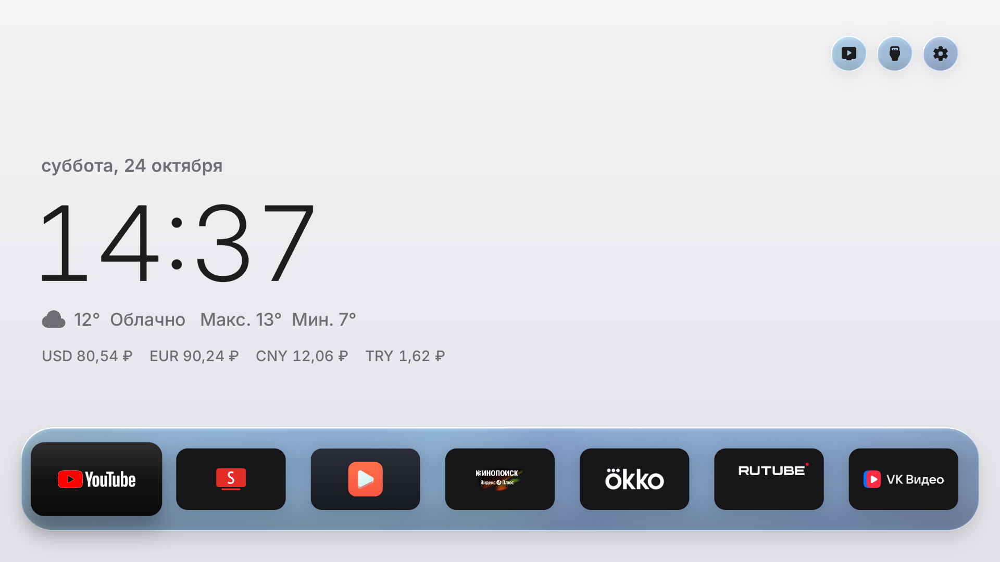 |

| Диалог «Разрешить отладку» | Настройки Free My TV (до переключения) |
|---|---|
| 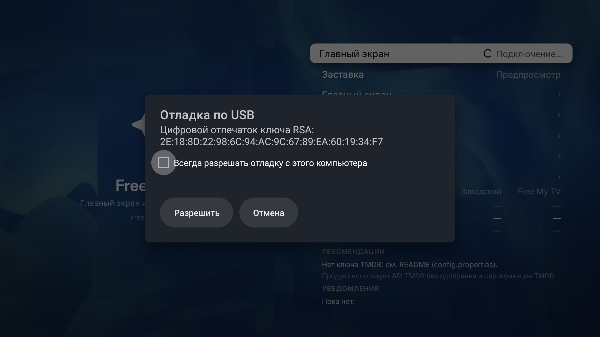 | 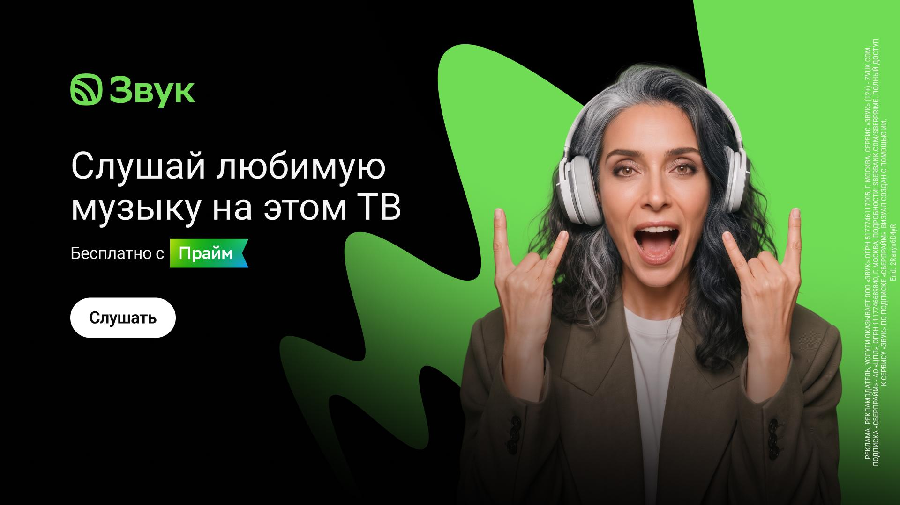 |

| Настройки после переключения | Домашний экран (первый запуск) |
|---|---|
| 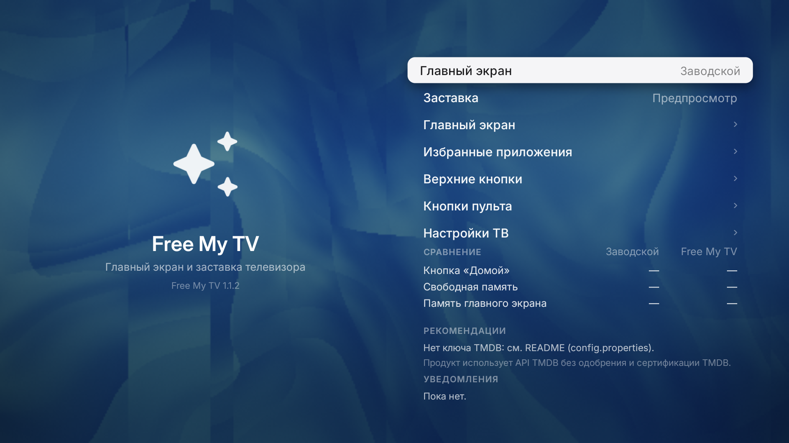 | 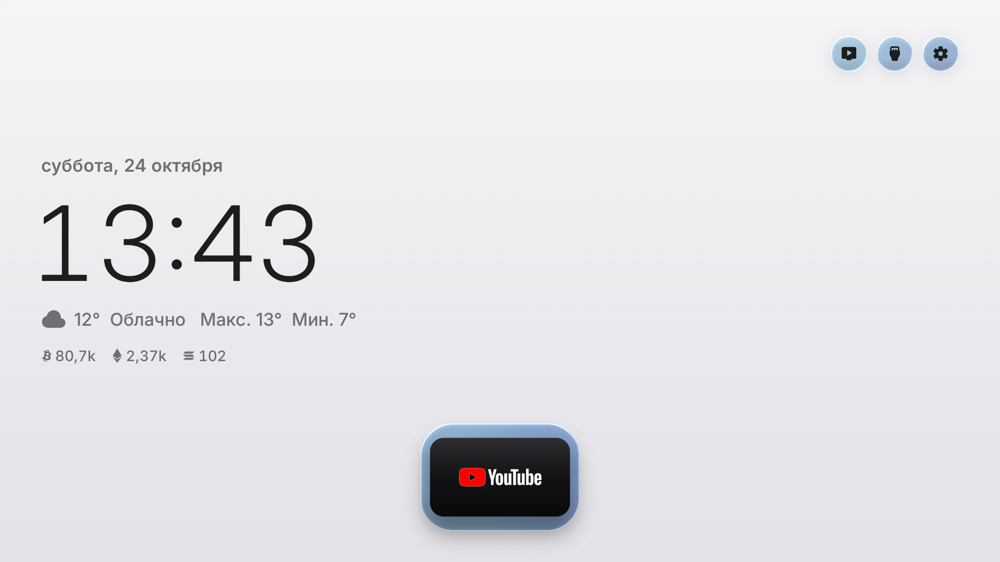 |

| Полка с приложениями | Курсы валют крупно |
|---|---|
| 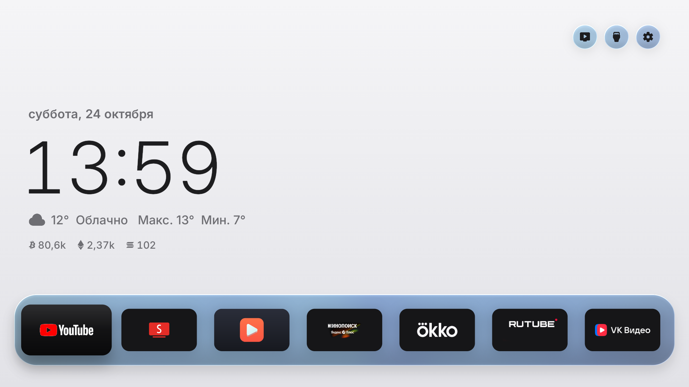 | 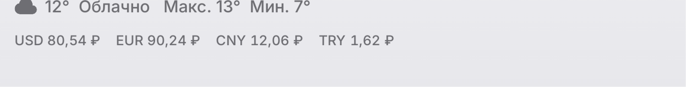 |

| «Приложения» — мусора Сбера больше нет | «Телеканалы» — родное приложение Сбера оставлено |
|---|---|
| 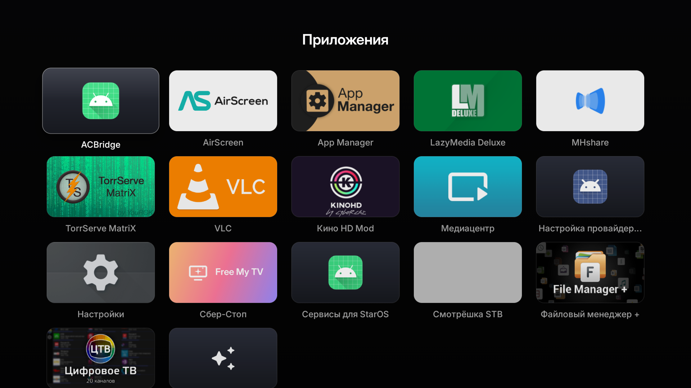 | 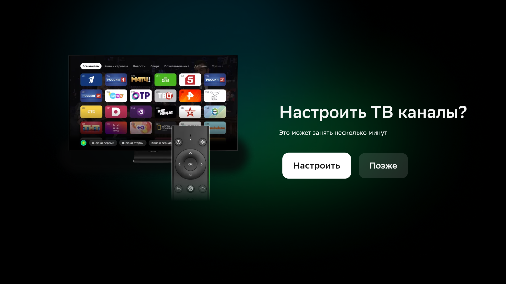 |

| SmartTube | YouTube (Google) |
|---|---|
| 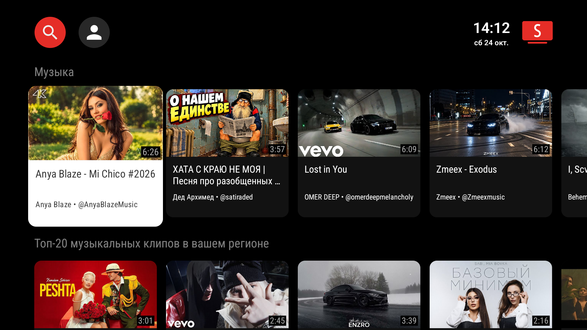 | 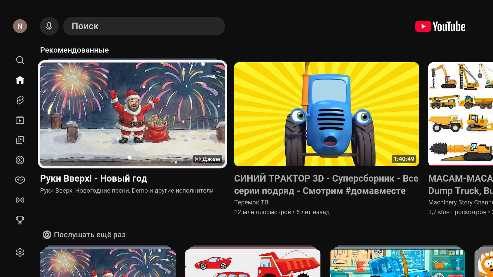 |

| СберTube: ошибка до лечения | СберTube: работает после отключения его SOCKS-прокси* |
|---|---|
| 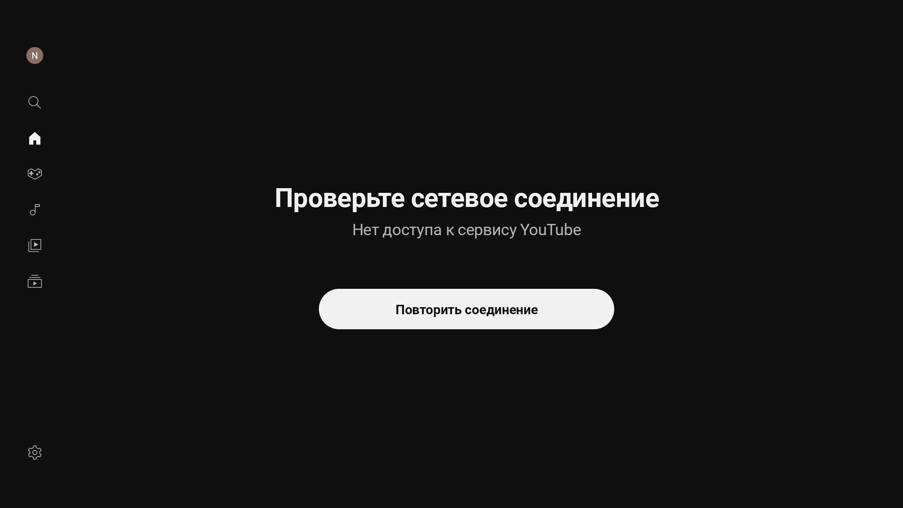 | 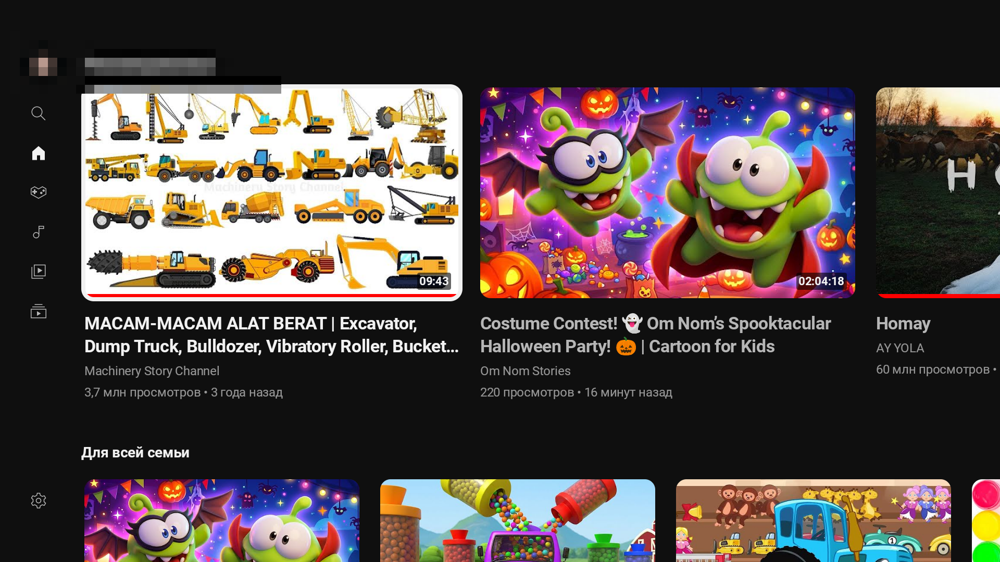 |

| «Сбер-Стоп» 1.4 (JobScheduler) | «Сбер-Стоп» 1.1 (первая версия) |
|---|---|
| 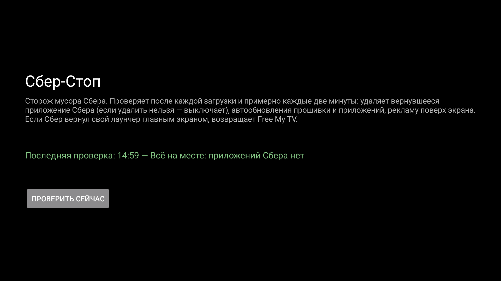 | 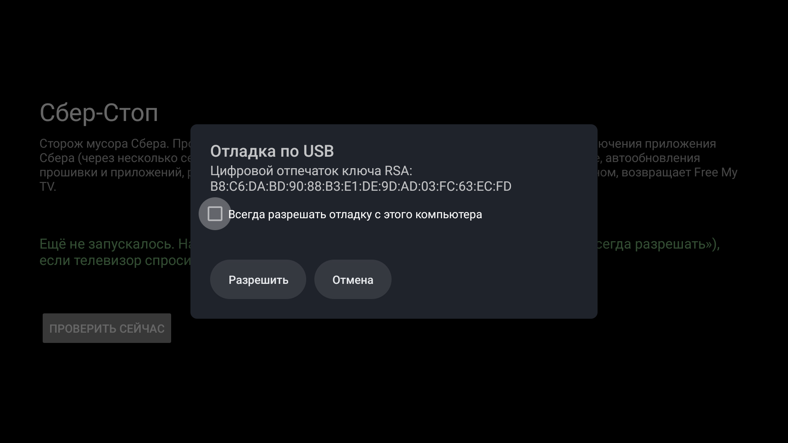 |

| После перезагрузки: главный экран — снова Free My TV | |
|---|---|
| 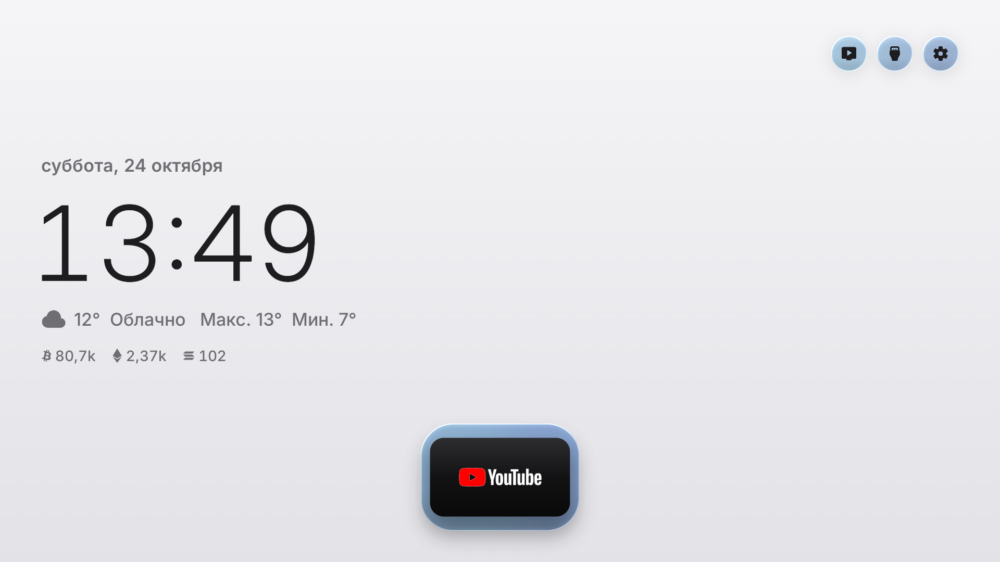 | |

\* На скриншоте 17 имя аккаунта в боковом меню намеренно размыто.

## Установка (по шагам)

Готовые APK — в [Releases](https://github.com/kryzhukov/sber-tv-at30a6-free-my-tv/releases/tag/v1.0) или в папке [`apk/`](apk).

Нужны: компьютер в той же сети, `adb` (Android platform-tools). На ТВ включена отладка по сети (порт 5555).

```powershell
$adb = "C:\platform-tools\adb.exe"          # свой путь к adb
& $adb connect <IP-ТВ>:5555                 # на ТВ подтвердить «Всегда разрешать»
& $adb install -r apk\FreeMyTV.apk
& $adb install -r apk\SberStop.apk

# 1) удалить мусор Сбера (список и объяснения — в docs/ИНСТРУКЦИЯ.md)
$junk = @(
  "ru.sberdevices.starlauncher","ru.sberdevices.starscreensaver","ru.sberdevices.starmarket",
  "ru.sberdevices.app.setup","ru.sberdevices.openbeta","ru.sberdevices.starcleaner",
  "ru.sberdevices.smarthome.promo","ru.sberdevices.starbrowser","ru.sberdevices.videos",
  "ru.sberdevices.music","ru.sberdevices.sberplay","ru.sberdevices.starprofile",
  "ru.sberdevices.subscriptions","ru.sberdevices.parentcontrol","ru.sberdevices.starkidsroom.prod",
  "ru.sberdevices.bugreporter","ru.sberdevices.survey","com.salute.star","com.sberbank.settings",
  "com.spocky.projengmenu")
foreach ($p in $junk) { & $adb shell "pm uninstall --user 0 $p" }

# 2) Free My TV главным экраном и заставкой, автообновления — выкл.
& $adb shell "cmd package set-home-activity io.freemytv/.HomeActivity"
& $adb shell "settings put secure screensaver_components io.freemytv/io.freemytv.Screensaver"
& $adb shell "settings put global ota_disable_automatic_update 1"
& $adb shell "settings put global auto_update_apps 0"

# 3) один раз открыть Free My TV → «Главный экран» → «Free My TV» (ТВ спросит разрешение отладки — «Всегда разрешать»)
# 4) один раз открыть «Сбер-Стоп» → «Проверить сейчас» (тоже «Всегда разрешать»)
```

Точное имя службы заставки смотрите на самом ТВ: `settings get secure screensaver_default_component`, затем подставьте его вместо примера. Подробная инструкция со всеми командами, списком «что оставлено специально» и откатом — **[docs/ИНСТРУКЦИЯ.md](docs/ИНСТРУКЦИЯ.md)**.

## Структура репозитория

```
apk/            FreeMyTV.apk, SberStop.apk (готовые, подписаны)
freemytv/       наш форк Free My TV (полные исходники app/, сборка build.sh / build-windows.ps1)
sberstop/       исходники сторожа «Сбер-Стоп» (Java, без Gradle) + скрипт сборки
docs/           ИНСТРУКЦИЯ.md (по-русски, всё по шагам), device-info.md
scripts/        debloat.ps1 (всё одной командой), collect-device-info.ps1
screenshots/    до/после
```

## Сборка

- **Free My TV**: `freemytv/build.sh` (Linux/macOS) или `freemytv/build-windows.ps1` (PowerShell; без Gradle: aapt2 → javac → d8 → zipalign → apksigner). Нужны JDK 17 и Android SDK (`build-tools;34`, `platforms;android-34`); скрипт Windows ждёт их в `%USERPROFILE%\dsh-tv-build`.
- **«Сбер-Стоп»**: `sberstop/build-sberstop.ps1` (те же инструменты).

Оба APK подписаны «тестовыми» ключами, которые лежат в репозитории (`freemytv.keystore`, пароль `freemytv`; `sberstop.keystore`, пароль `sberstop`) — чтобы можно было собрать обновление поверх установленного. Ключи не для продакшена.

## Про смену прошивки — честно: нельзя

Для SaluteTV AT30A6 нет публичной «чистой Android TV»: загрузчик залочен, публичных образов нет, GSI не подходит (ТВ 32-битный, а GSI с Android 13 — только ARM64; плюс в GSI нет драйверов тюнера/HDMI/CEC/пульта). Единственное официальное — переустановка **стоковой** прошивки с флешки (`sberdevices.ru/firmware_tv`). Поэтому выбран путь «вырезать Сбер по максимуму без паяльника», который здесь и лежит.

## Важно

- Прошивка Сбера **при каждой загрузке возвращает свой лаунчер** — «Сбер-Стоп» снова его удаляет (главный экран при этом остаётся Free My TV). Совсем вырезать без root нельзя.
- Не удаляйте `ru.sberdevices.assistant`, `services`, `gamepad.service`, `onekey`, `rcfupdater`, `starlivetv`, `tvinputs`, `settings`, `startube` — без них отвалятся пульт, Homuz, телеканалы и настройки ТВ.
- Сброс ТВ к заводским настройкам вернёт всё как было (и мусор Сбера тоже).
- ADB-разрешение «Всегда разрешать» выдаётся один раз на устройство; отключить саму проверку можно только с root.

## Лицензия и благодарности

- Наш код (скрипты, «Сбер-Стоп», правки Free My TV) — **MIT**, см. [LICENSE](LICENSE).
- **Free My TV** © [simbasjungles](https://github.com/simbasjungles/free-my-tv) — MIT; полный текст в [freemytv/LICENSE](freemytv/LICENSE).
- **SmartTube** © [yuliskov](https://github.com/yuliskov/SmartTube) — отдельное приложение, ставится с официального GitHub Releases (в репозитории его нет).
- Шрифт Inter (SIL OFL), иконки Material Symbols (Apache 2.0) — внутри Free My TV.
- Проект не связан со Сбером, Google, CVTE и Amlogic. Все торговые марки принадлежат владельцам.
