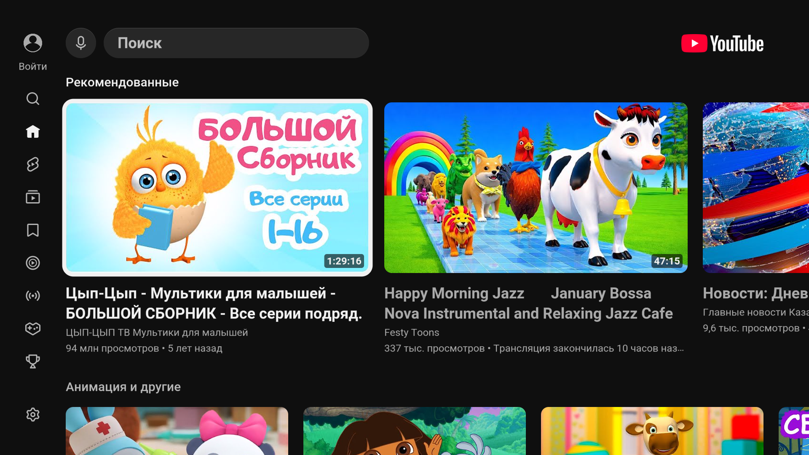

# YouTube через Cobalt — приложение «YouTube.com» (как на Яндексовых ТВ)

Приложение **`com.yandex.tv.ytplayer`** (на экране — **«YouTube.com»**) — это клиент YouTube TV от Яндекса, который работает на рантайме
**Cobalt** (HTML5/JS-движок, тот же, что в Smart TV Яндекса). Ставится на SaluteTV AT30A6 и полностью работает: интерфейс YouTube TV,
поиск, подборки, воспроизведение (H.264 / VP9 / AV1 через аппаратные декодеры Amlogic), вход в аккаунт по коду.

Ключевое: **GMS, Play Services и Widevine не нужны.** На AT30A6 их нет — и это не мешает.

> Это **не** «официальное приложение YouTube» из Play Маркета. Это веб-обёртка Cobalt: интерфейс, рекомендации и **реклама** приходят
> с серверов `youtube.com/tv`. Поэтому «вырезать рекламу из APK» бессмысленно — её там нет. Без рекламы по-прежнему **SmartTube**.

## Что это за приложение

| Параметр | Значение (проверено на AT30A6) |
|---|---|
| Пакет | `com.yandex.tv.ytplayer` |
| Название | «YouTube.com» |
| Версия | **1.1.93** (versionCode 93) |
| Подпись | `CN=Yandex, OU=Yandex.TV` — не платформенный ключ |
| Размер / MD5 | 27 710 554 Б / `f39e535b8aaa75d76c8a89733a2603f0` |
| Архитектура | `armeabi-v7a` (32-бит) — как раз наш SoC |
| minSdk / targetSdk | 28 / 29 (Android 9+ / 13 подходит) |
| Активность запуска | `dev.cobalt.app.MainActivity` |
| Стартовый URL | `https://www.youtube.com/tv` |
| Внутри | `lib/armeabi-v7a/libcoat.so` (движок Cobalt, ~24 МБ), 839 ассетов (шрифты, ICU, SSL) |
| Разрешения | `INTERNET`, `RECORD_AUDIO` (голосовой поиск), `POST_NOTIFICATIONS` |
| Deep links | `youtube.com`, `m.youtube.com`, `youtu.be` |
| Требуется от системы | ничего из Сбера, ничего от Google |

## Откуда взять APK

**Способ 1 — снять с любого телевизора на YaOS** (там он предустановлен системным приложением):

```bash
adb connect <IP-ЯНДЕКС-ТВ>:5555
adb -s <IP-ЯНДЕКС-ТВ>:5555 shell pm path com.yandex.tv.ytplayer
# package:/system/app/YtPlayer/YtPlayer.apk
adb -s <IP-ЯНДЕКС-ТВ>:5555 pull /system/app/YtPlayer/YtPlayer.apk YtPlayer.apk
```

**Способ 2 — взять готовый файл** у нас (он же лежит рядом с этим репозиторием) и сверить контрольную сумму:

```bash
md5sum YtPlayer.apk
# f39e535b8aaa75d76c8a89733a2603f0  YtPlayer.apk
```

## Установка, вариант A — обычным приложением (без root, ~1 минута)

```bash
adb connect 192.168.1.118:5555
adb -s 192.168.1.118:5555 install -r YtPlayer.apk
# Success

# микрофон (голосовой поиск) — без этого поиск голосом не работает
adb -s 192.168.1.118:5555 shell pm grant com.yandex.tv.ytplayer android.permission.RECORD_AUDIO

# первый запуск
adb -s 192.168.1.118:5555 shell am start -n com.yandex.tv.ytplayer/dev.cobalt.app.MainActivity
```

Плитка **«YouTube.com»** появляется в лаунчере сама (у приложения есть `LEANBACK_LAUNCHER`), отдельно ничего добавлять не нужно.

## Установка, вариант B — системным приложением (нужен root)

Смысл: сделать ровно как на Яндексовом ТВ — приложение лежит в `/system/app/YtPlayer/`, показывается в списке штатных,
не удаляется из лаунчера и переживает сброс к заводским настройкам.

На AT30A6 root уже есть (`/system/bin/su`, `su -c id` → `uid=0`), dm-verity выключена (`ro.boot.veritymode=disabled`), поэтому раздел
`/` перемонтируется в rw.

```bash
adb connect 192.168.1.118:5555

# 1) ставим и запоминаем, откуда берём файл
adb -s 192.168.1.118:5555 install -r YtPlayer.apk
adb -s 192.168.1.118:5555 shell 'pm path com.yandex.tv.ytplayer'

# 2) копируем в /system (root)
adb -s 192.168.1.118:5555 shell 'su -c "
set -e
APK=\$(pm path com.yandex.tv.ytplayer | sed s/package://)
mount -o remount,rw /
mkdir -p /system/app/YtPlayer
cp \$APK /system/app/YtPlayer/YtPlayer.apk
chown root:root /system/app/YtPlayer /system/app/YtPlayer/YtPlayer.apk
chmod 755 /system/app/YtPlayer
chmod 644 /system/app/YtPlayer/YtPlayer.apk
chcon u:object_r:system_file:s0 /system/app/YtPlayer /system/app/YtPlayer/YtPlayer.apk
sync
md5sum /system/app/YtPlayer/YtPlayer.apk
mount -o remount,ro /
"'

# 3) убираем копию из /data/app, чтобы после загрузки осталась только системная
adb -s 192.168.1.118:5555 shell 'su -c "pm uninstall com.yandex.tv.ytplayer"'

# 4) перезагрузка — PackageManager увидит приложение в /system
adb -s 192.168.1.118:5555 reboot
```

После загрузки (30–60 с) проверить:

```bash
adb -s 192.168.1.118:5555 shell 'pm path com.yandex.tv.ytplayer; dumpsys package com.yandex.tv.ytplayer | grep -m1 "flags=\["'
# package:/system/app/YtPlayer/YtPlayer.apk
# flags=[ SYSTEM HAS_CODE ALLOW_CLEAR_USER_DATA ALLOW_BACKUP ]   ← как на Яндекс-ТВ
```

Затем один раз выдать микрофон (после переустановки разрешение сбрасывается):

```bash
adb -s 192.168.1.118:5555 shell 'su -c "pm grant com.yandex.tv.ytplayer android.permission.RECORD_AUDIO"'
```

Всё это автоматизировано: **[scripts/install-cobalt-youtube.sh](../scripts/install-cobalt-youtube.sh)**
(`--mode user` — вариант A, `--mode system` — вариант B, `--reboot` — перезагрузить в конце).

## Как проверить, что действительно работает

1. **Пакет и флаги** — команды выше: путь `/system/app/YtPlayer/YtPlayer.apk` и флаг `SYSTEM`.

2. **Плитка в лаунчере:**

```bash
adb -s 192.168.1.118:5555 shell 'cmd package query-activities --brief -a android.intent.action.MAIN -c android.intent.category.LEANBACK_LAUNCHER | grep ytplayer'
# com.yandex.tv.ytplayer/dev.cobalt.app.MainActivity
```

3. **Логи Cobalt** — самое надёжное. Запустить видео и посмотреть:

```bash
adb -s 192.168.1.118:5555 logcat | grep -E "starboard_media|StoryManager" 
```

В норме видно, что приложение нашло аппаратный декодер и играет:

```
starboard_media: Found suitable decoder, OMX.amlogic.avc.decoder.awesome2
starboard_media: Found suitable decoder, OMX.amlogic.av1.decoder.awesome2
StoryManager: onPlaybackInfoUpdate: state=playing <название>, <длительность>, https://www.youtube.com/tv#/watch?v=…
starboard_media: MediaSession state: PLAYING, position: … ms
```

На AT30A6 есть даже **AV1**-декодер (`OMX.amlogic.av1.decoder.awesome2`), так что 4K AV1-потоки YouTube тоже идут.

4. **Скриншот рабочего экрана:**



## Нюансы, о которых стоит знать заранее

- **Чёрный экран 10–20 секунд при старте** — это норма: Cobalt скачивает и поднимает веб-приложение YouTube. Не паника и не «сломалось».
- **`screencap` не захватывает видео-слой** Amlogic: если идёт полноэкранное видео, скриншот будет чёрным, хотя на экране всё видно.
  Скриншот корректно снимается с интерфейса (главная, поиск, настройки).
- **Реклама остаётся** — она серверная, в APK её нет и вырезать нечего. Если нужен YouTube без рекламы — это **SmartTube** (в репозитории про него есть).
- **Widevine нет** (как и на всём AT30A6) — DRM-сервисы и часть платного контента работать не будут. Обычный YouTube — работает.
- **Вход в аккаунт**: на экране входа показан код, его надо ввести на `google.com/device` с телефона/компьютера.
- **Автообновлений не будет**: Play Маркета нет. Новая версия — только новой установкой APK (и она должна быть подписана тем же ключом Яндекса,
  иначе Android откажется обновлять; поэтому в лаунчере не будет «обновить»).
- **Голосовой поиск** работает только после выдачи `RECORD_AUDIO` (или через настройки → приложения → YouTube.com → разрешения).
- Разрешение `GET_ACCOUNTS` приложению не нужно — оно и на Яндекс-ТВ не выдано.

## Откат

```bash
# если ставили вариантом B (системное)
adb -s 192.168.1.118:5555 shell 'su -c "mount -o remount,rw / && rm -rf /system/app/YtPlayer && sync && mount -o remount,ro /"'
adb -s 192.168.1.118:5555 reboot

# если вариантом A (обычное)
adb -s 192.168.1.118:5555 uninstall com.yandex.tv.ytplayer
```

## Почему именно Cobalt, если на ТВ уже есть YouTube и SmartTube

| Клиент | Плюсы | Минусы |
|---|---|---|
| Google YouTube TV (`com.google.android.youtube.tv`) | родной, быстрый | требует Play Services/аккаунт Google, на AT30A6 живёт «на честном слове» |
| **SmartTube** (`org.smarttube.stable`) | без рекламы, гибкие настройки | свой интерфейс, не «как на телевизоре» |
| СберTube (`ru.sberdevices.startube`) | работает без VPN, если выключить его SOCKS-прокси | интерфейс Сбера |
| **Cobalt «YouTube.com»** (этот документ) | тот самый интерфейс YouTube TV, без GMS, 32-бит, аппаратные кодеки | реклама, нет автообновлений, 27 МБ в /system |

Cobalt удобен как «четвёртый клиент»: если Google-версия капризничает, а SmartTube не нравится по интерфейсу — Cobalt даёт привычный
YouTube TV, как на телевизорах Яндекса, и не требует ни Play, ни Widevine.
